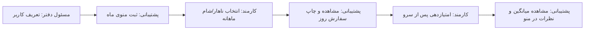
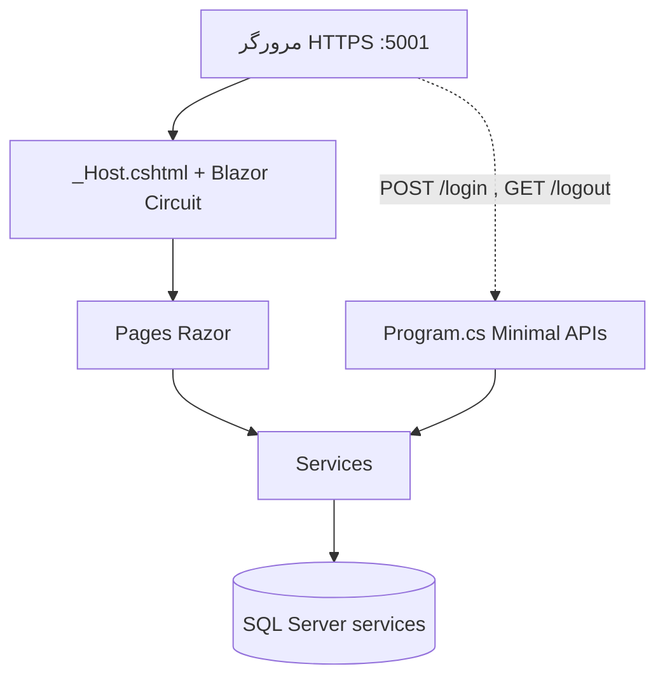

# نمای کلی محصول

**وضعیت کلی این سند:** Verified برای ساختار محصول از روی سورس فعلی؛ Partially Verified برای نام تجاری و مرز سازمان، چون اسکیمای واقعی دیتابیس و سند کسب‌وکار جدا در مخزن نیست.

---

## ۱. معرفی محصول

سامانه فعلی یک اپلیکیشن **Blazor Server** با نام فنی `ServiceApp` است که رزرو غذای کارکنان یک سازمان را پوشش می‌دهد.

- عنوان مرورگر: `Afagh Company` (`ServiceApp/Pages/_Host.cshtml`)
- نسخه نمایش‌داده‌شده در صفحه ورود: `3.0.5` (`ServiceApp/Pages/Login.razor`)
- فریم‌ورک: ASP.NET Core 8 / Blazor Server (`ServiceApp/ServiceApp.csproj`, `Program.cs`)
- پایگاه داده: SQL Server، دیتابیس `services` از طریق `ConnectionStrings:DefaultConnection` در `appsettings.json`

از منظر کسب‌وکار، محصول یک **سامانه رزرو ماهانه غذا** است: پشتیبانی منوی روزانه را ثبت می‌کند، کارکنان برای هر روز ناهار و/یا شام انتخاب می‌کنند، و پشتیبانی سفارش‌های روز را برای آشپزخانه/رستوران مشاهده و چاپ می‌کند.

---

## ۲. مسئله کسب‌وکار که حل می‌کند

بر اساس رفتار پیاده‌سازی‌شده (نه فرض مدل کسب‌وکار جدا):

1. انتخاب غذای کارکنان باید قبل از موعد مشخص انجام شود (ناهار تا ساعت ۱۴ روز قبل؛ شام تا ساعت ۱۴ همان روز).
2. منوی هر روز حداکثر سه گزینه ناهار و دو گزینه شام دارد.
3. پشتیبانی باید بتواند تعداد غذای هر روز را به‌تفکیک دپارتمان و نوع غذا ببیند و چاپ کند.
4. امکان ثبت غذا برای مهمان و برای کاربری که خودش رزرو نکرده وجود دارد.
5. کارکنان می‌توانند بعد از سرو غذا امتیاز و نظر کوتاه ثبت کنند.

---

## ۳. کاربران هدف

کاربران محصول، کارکنان داخلی سازمان هستند که با نام کاربری و رمز وارد می‌شوند. نقش‌ها از فیلد `User.Role` خوانده می‌شوند:

| نقش در داده | نقش کسب‌وکار مشاهده‌شده | منبع |
|---|---|---|
| `کاربر` | کارمند رزروکننده غذا | `MainLayout.razor`، `UserReserve.razor`، فرم نقش در `UserManagement.razor` |
| `پشتیبانی` | اپراتور غذا / آشپزخانه | `FoodReservations.razor`، `MenuManagement.razor` |
| `مسئول دفتر` | مدیر کاربران | `UserManagement.razor` |
| `مدیریت` | مشاهده منو (محدود) | `[Authorize(Roles = "پشتیبانی,مدیریت")]` در `MenuManagement.razor` |
| `شبکه` | قابل انتساب؛ ماژول اختصاصی ندارد | گزینه نقش در `UserManagement.razor` |

جزئیات دسترسی در `02-roles-and-permissions.md` آمده است.

---

## ۴. فرایندهای اصلی کسب‌وکار

چرخه عملیاتی تکرارشونده:

1. **تعریف هویت:** مسئول دفتر کاربر، نقش، دپارتمان و وضعیت استخدام را ثبت می‌کند.
2. **تعریف منو:** پشتیبانی برای هر روز شمسی گزینه‌های ناهار/شام را می‌نویسد و در صورت نیاز پرچم تعطیل/رمضان را در UI می‌بیند.
3. **انتخاب ماهانه:** کارمند تقویم ماه را می‌بیند و با تغییر هر سلکت، همان لحظه ذخیره می‌شود.
4. **عملیات روزانه پشتیبانی:** افزودن مهمان/کاربر، حذف نرم وعده، چاپ لیست رستوران.
5. **بازخورد:** امتیاز ۱ تا ۵ و نظر حداکثر ۲۰ کاراکتر فارسی.

---

## ۵. حوزه‌های کارکردی عمده

| حوزه | مسیر اصلی | وضعیت |
|---|---|---|
| احراز هویت و امنیت ورود | `/login`, `/logout`, `/change-password` | Fully Implemented با چند شکاف (قفل حساب هست؛ اجبار ماندن در صفحه تغییر رمز پس از ورود نیست) |
| داشبورد شخصی | `/dashboard` | Fully Implemented برای نمایش IP و تاریخچه ورود |
| رزرو ماهانه کارمند | `/user-reservation` | Fully Implemented به‌عنوان مسیر اصلی محصول |
| مدیریت منو | `/menu-management` | Partially Implemented برای پرچم تعطیل/رمضان در به‌روزرسانی رکورد موجود |
| گزارش و عملیات رزرو | `/food-reservations` | Fully Implemented برای نقش پشتیبانی |
| مدیریت کاربران | `/user-management` | Fully Implemented برای مسئول دفتر |
| اعلان لحظه‌ای | `signalr` + `notifications.js` | Partially Implemented / عملاً ناقص |

---

## ۶. مرزهای محصول

**داخل محدوده فعلی (Verified):**

- ورود کوکی‌محور
- رزرو ناهار و شام روی منوی روزانه
- امتیاز و نظر روی وعده رزروشده
- گزارش روزانه/ماهانه و چاپ مرورگر
- مدیریت کاربر و بازنشانی رمز/IP

**خارج از محدوده مشاهده‌شده در سورس:**

- کاتالوگ مستقل غذا (نام غذا متن آزاد روی `DailyMenu` است)
- پرداخت، کیف پول، قیمت غذا
- اپ موبایل جدا، API عمومی REST برای رزرو
- ایمیل، پیامک، تقویم سازمانی خارجی
- گردش تأیید چندمرحله‌ای سفارش
- انبار یا تأمین‌کننده رستوران

**نیمه‌کاره در مرز محصول:**

- نوتیفیکیشن SignalR (`AddSignalR` بدون Hub، فایل `wwwroot/js/notifications.js` موجود نیست)
- نقش‌های `شبکه` و `مدیریت` بدون سفر کاری کامل
- فیلدهای `EmploymentStatus` و `StaticIP` ذخیره می‌شوند اما در رزرو یا محدودسازی ورود استفاده نمی‌شوند

---

## ۷. سیستم‌های بیرونی و یکپارچگی

| مورد | شواهد | وضعیت |
|---|---|---|
| SQL Server (`172.16.8.109` / `services`) | `appsettings.json` | Verified به‌عنوان تنها منبع پایدار داده |
| گواهی HTTPS محلی `C:\myca\mycert.pfx` | `Program.cs` | Verified وابستگی اجرا؛ فایل داخل مخزن نیست |
| گواهی ریشه برای کلاینت | `wwwroot/install/ca.cert.crt` و PDF آموزش | Verified دانلود استاتیک |
| SignalR / اعلان | `_Host.cshtml`, `Program.cs` | Partially Verified؛ هاب و JS اختصاصی نیست |
| HttpClient به `https://localhost:5001` | `Program.cs` | ثبت شده؛ مصرف‌کننده در صفحات یافت نشد (Unverified به‌عنوان یکپارچگی واقعی) |
| MudBlazor / JWT / Azure / SQLite / Blazored.Toast | `ServiceApp.csproj` | پکیج هست؛ رفتار محصولی متصل نیست |

ایمیل، پیام‌رسان، و شغل زمان‌بندی‌شده (`IHostedService`) در سورس یافت نشد. **Verified: وجود ندارد.**

---

## ۸. اصطلاحات محصول

| اصطلاح UI/کسب‌وکار | شناسه فنی | معنی در پیاده‌سازی فعلی |
|---|---|---|
| سامانه / ورود به سامانه | `ServiceApp` | اپ Blazor Server |
| کاربر | نقش `کاربر` و موجودیت `User` | کارمند رزروکننده |
| پشتیبانی | نقش `پشتیبانی` | اپراتور منو و گزارش رزرو |
| مسئول دفتر | نقش `مسئول دفتر` | مدیر حساب‌های کاربری |
| منو | `DailyMenu` | گزینه‌های غذای یک روز تقویم |
| رزرو / سفارش | `FoodReservation` | انتخاب ناهار/شام یک کاربر در یک تاریخ |
| ناهار | `Lunch`, `MealType.Lunch` | وعده اول |
| شام | `Dinner`, `MealType.Dinner` | وعده دوم |
| مهمان | `UserId = 129`، نام کاربری `مهمان` | رزروهای ثبت‌شده توسط پشتیبانی برای مهمان |
| نگهبانی / گارد | پیشوند نام کاربری `Guards-` و دپارتمان `نگهبانی` | شام گارد در گزارش ناهار شمرده می‌شود |
| حذف شده توسط پشتیبانی | مقدار متنی در `Lunch`/`Dinner` | حذف نرم وعده |
| رمضان | `DailyMenu.IsRamezan` | در UI کارمند مهلت را به ساعت ۱۳ همان روز تغییر می‌دهد |
| تعطیل | `DailyMenu.IsHoliday` | فقط رنگ ردیف؛ رزرو را در کد کارمند قفل نمی‌کند |
| وضعیت استخدام | `EmploymentStatus` با مقادیر `state_1` تا `state_3` | ذخیره می‌شود؛ معنی کسب‌وکار در سورس نیست |
| آی‌پی ثابت | `User.StaticIP` | اولین IP ورود موفق؛ در داشبورد نمایش داده می‌شود |
| امتیاز کلی | میانگین `LunchRating`/`DinnerRating` روی همان نام غذا | محاسبه‌شده در `MenuService`؛ ذخیره جداگانه ندارد |

---

## ۹. ساختار سطح بالای محصول

لایه جدا برای API JSON رزرو وجود ندارد. صفحات Razor مستقیماً سرویس‌های Scoped را صدا می‌زنند.

منبع: `Program.cs`، صفحات `ServiceApp/Pages/`، سرویس‌های `ServiceApp/Services/`.
