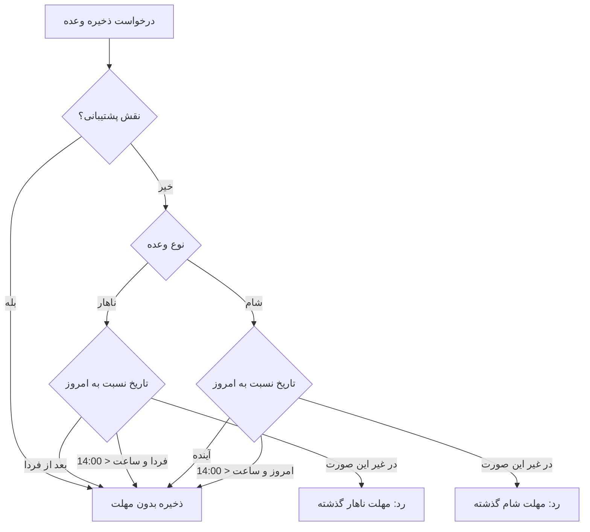

# دامنه کسب‌وکار و قواعد کسب‌وکار

این سند فقط قواعدی را ثبت می‌کند که در سورس فعلی قابل ردیابی هستند. مثال‌های مأموریت (مثل محدودیت سهمیه ماهانه) اگر پیاده نشده باشند، صریحاً «پیاده نشده» علامت خورده‌اند.

---

## ۱. مفاهیم دامنه

| مفهوم | موجودیت/مکان | معنی |
|---|---|---|
| کاربر سازمانی | `User` | هویت ورود، نقش، دپارتمان، وضعیت استخدام، هش رمز، لاگ ورود |
| منوی روز | `DailyMenu` | تا ۳ ناهار و ۲ شام به‌صورت متن آزاد برای یک `Date` |
| رزرو روز | `FoodReservation` | یک رکورد به‌ازای کاربر+تاریخ با فیلدهای `Lunch` و `Dinner` |
| لاگ رزرو | `FoodReservationLog` | ثبت موفقیت/شکست ایجاد، ویرایش، حذف |
| خلاصه روز | `DailyFoodSummary` | مدل محاسبه‌ای تعداد هر غذا؛ جدول نیست |
| سفارش نمایشی روز | `DailyUserOrder` | DTO برای گزارش؛ جدول نیست |
| تقویم شمسی | `PersianCalendarHelper` | مبنای ماه، روز، نام روز |

کاتالوگ غذا، دوره انتخاب جدا از ماه تقویم، و موجودیت «سفارش» مستقل از رزرو روز **در سورس وجود ندارد.**

---

## ۲. چرخه عمر

### ۲.۱ منو

1. پشتیبانی ماه شمسی را باز می‌کند.
2. برای روزهای بدون رکورد، `DailyMenu` خالی در حافظه ساخته می‌شود (`MenuManagement.LoadMenus`).
3. ذخیره `MenuService.SaveOrUpdateAsync`: اگر ردیف همان تاریخ باشد به‌روزرسانی نام غذاها؛ وگرنه insert.
4. امتیاز میانگین و نظرات در ذخیره منو نیستند؛ هنگام خواندن از رزروها محاسبه می‌شوند.

### ۲.۲ رزرو

1. ایجاد: اولین انتخاب ناهار یا شام برای آن روز (`Action = Create`).
2. به‌روزرسانی: تغییر یا خالی‌کردن وعده (`Action = Update`).
3. حذف نرم توسط پشتیبانی: مقدار وعده می‌شود `"حذف شده توسط پشتیبانی"` (`SoftDeleteMealAsync`).
4. امتیاز: پس از سرو، روی همان رکورد رزرو نوشته می‌شود.

حذف فیزیکی رزرو در سرویس رزرو پیاده نشده است.

### ۲.۳ حساب کاربری

ایجاد توسط مسئول دفتر → ورود → در صورت رمز `1234` هدایت به تغییر رمز → استفاده از ماژول نقش → بازنشانی رمز/IP یا حذف (با محدودیت‌های نقش).

---

## ۳. قواعد کسب‌وکار

### BR-01 — مهلت رزرو/ویرایش ناهار (سرور)

| مورد | مقدار |
|---|---|
| شرح | کارمند غیرپشتیبانی فقط اگر تاریخ ناهار فردا باشد و ساعت فعلی قبل از ۱۴:۰۰ باشد، یا تاریخ بعد از فردا باشد، می‌تواند ناهار را ایجاد/تغییر/حذف کند. ناهار امروز و گذشته مجاز نیست. |
| محرک | `FoodReservationService.SaveOrUpdateAsync` وقتی مقدار ناهار تغییر کند یا ناهار موجود خالی شود |
| رفتار | `InvalidOperationException` با پیام مهلت؛ لاگ `Failed` |
| موجودیت | `FoodReservation.Date`, `Lunch` |
| پیاده‌سازی | `IsAllowedToEditMeal(..., MealType.Lunch)` خطوط ۳۶۴–۳۷۲ در `FoodReservationService.cs` |
| وضعیت | Verified |
| ابهام | با قاعده رمضان UI (ساعت ۱۳ همان روز) هم‌خوان نیست. سرور رمضان را جداگانه اعمال نمی‌کند. |

### BR-02 — مهلت رزرو/ویرایش شام (سرور)

| مورد | مقدار |
|---|---|
| شرح | شام امروز فقط قبل از ۱۴:۰۰؛ شام آینده آزاد؛ شام گذشته ممنوع. پشتیبانی مستثنا است. |
| محرک | تغییر یا حذف `Dinner` در `SaveOrUpdateAsync` |
| پیاده‌سازی | `IsAllowedToEditMeal(..., MealType.Dinner)` خطوط ۳۷۴–۳۷۷ |
| وضعیت | Verified |
| ابهام | UI رمضان شام را تا ۱۳:۰۰ همان روز محدود می‌کند؛ سرور همان ۱۴:۰۰ را دارد. |

### BR-03 — استثنای نقش پشتیبانی از مهلت

| مورد | مقدار |
|---|---|
| شرح | اگر `HttpContext.User` در نقش `پشتیبانی` باشد، بررسی مهلت انجام نمی‌شود. |
| پیاده‌سازی | `bool isSupport = currentUser?.IsInRole("پشتیبانی")` سپس `&& !isSupport` روی پرتاب استثنا |
| وضعیت | Verified |
| ابهام | سایر نقش‌ها (مسئول دفتر، مدیریت) این استثنا را ندارند. اگر از `/user-reservation` ذخیره کنند، مهلت سرور اعمال می‌شود. |

### BR-04 — نمایش مهلت در صفحه کارمند (غیر رمضان)

متن زرد: «رزرو شام تا ساعت ۱۴ همان روز امکان‌پذیر است *** رزرو ناهار تا ساعت ۱۴ روز قبل انجام می‌شود».

منبع: `UserReserve.razor` حدود ۳۵۲–۳۵۴.

منطق UI سلکت‌ها: ناهار فردا تا ۱۴:۰۰؛ ناهار پس‌فردا و بعد آزاد؛ شام امروز تا ۱۴:۰۰؛ شام آینده آزاد. **Verified** و با BR-01/BR-02 هم‌راستا است.

### BR-05 — نمایش مهلت رمضان در UI کارمند

اگر منوی **امروز** `IsRamezan == true` باشد، بنر می‌گوید افطار/شام تا ساعت ۱۳ همان روز.

منطق سلکت برای روز رمضان:

- ناهار امروز تا ۱۳:۰۰؛ ناهار آینده آزاد (نه الگوی روز قبل)
- شام امروز تا ۱۳:۰۰

منبع: `UserReserve.razor` ۳۴۴–۴۲۳.

**Partially Verified / Requires Business Confirmation:** سرور این مهلت ۱۳:۰۰ را اعمال نمی‌کند. کارمند می‌تواند در UI تا ۱۳ قفل شود اما اگر مسیر دیگری `SaveOrUpdateAsync` را صدا بزند، تا ۱۴:۰۰ طبق BR-01/02 قبول می‌شود. همچنین `isCurrentRamezan` فقط از منوی امروز خوانده می‌شود، در حالی که مهلت هر ردیف از `menu.IsRamezan` همان روز است.

### BR-06 — ذخیره آنی با تغییر سلکت

تغییر ناهار یا شام بلافاصله `Save(day)` و سپس `FoodReservationService.SaveOrUpdateAsync` را صدا می‌زند. دکمه «ثبت ماه» وجود ندارد.

منبع: `OnLunchChanged` / `OnDinnerChanged` / `Save` در `UserReserve.razor`.

**Verified.** این رفتار هسته سفر ماهانه کارمند است و نباید در این ممیزی تغییر پیشنهاد شود.

### BR-07 — یک رزرو به‌ازای کاربر و روز (به‌جز UserId 129)

اگر `reservation.Id == 0` و `UserId != 129`، سرور رزرو موجود همان تاریخ را پیدا می‌کند، فیلد خالی ورودی را با مقدار قبلی پر می‌کند، و به‌روزرسانی می‌کند نه insert تکراری.

منبع: `FoodReservationService.SaveOrUpdateAsync` خطوط ۶۲–۸۶.

**Verified.**

### BR-08 — چند رزرو مهمان روی UserId 129

اگر `UserId == 129` و `Id == 0`، جستجوی رکورد موجود انجام نمی‌شود؛ هر بار insert جدید.

منبع: همان متد، شرط `else if (reservation.UserId != 129)`.

مصرف: `FoodReservations.AddGuestMeal` با `UserId = 129` و دپارتمان `"نگهبانی"`.

**Verified** از نظر کد. **Requires Business Confirmation** که ۱۲۹ همیشه کاربر مهمان در دیتابیس واقعی است (در سورس seed نیست).

### BR-09 — ادغام وعده هنگام ذخیره ناقص

اگر رزرو موجود باشد و ورودی ناهار یا شام خالی باشد، مقدار قبلی حفظ می‌شود (خطوط ۷۸–۸۲). حذف صریح با `DeleteLunch`/`DeleteDinner` مقدار را `""` می‌گذارد و سپس `Save` می‌کند؛ در آن حالت شاخه حذف مهلت (خطوط ۱۱۸–۱۵۶ و ۱۹۸–۲۳۶) اجرا می‌شود.

**Verified.** ابهام: تمایز «خالی به‌معنای بدون تغییر» و «خالی به‌معنای حذف» به `Id` و وجود `existing` وابسته است.

### BR-۱۰ — گزینه‌های غذا فقط از منوی همان روز

سلکت کارمند فقط `Lunch1..3` و `Dinner1..2` همان `DailyMenu` را نشان می‌دهد. اگر منو نباشد، فقط گزینه خالی «انتخاب ناهار/شام» هست.

**Verified** در `UserReserve.razor`. سهمیه تعداد انتخاب در روز/ماه **پیاده نشده** است.

### BR-11 — رفتار ویژه نام کاربری `Guards-` در انتخاب شام (غیر رمضان)

اگر نام کاربر با `Guards-` شروع شود و روز رمضان نباشد، گزینه‌های شام از `Lunch1..3` منو پر می‌شوند نه `Dinner1..2`.

منبع: `UserReserve.razor` ۵۲۰–۵۳۴.

**Partially Verified.** مقایسه `selected` با `reservation.Lunch` نوشته شده نه `reservation.Dinner`؛ ممکن است نمایش انتخاب‌شده نادرست باشد. معنای کسب‌وکار (گارد شام را از منوی ناهار می‌گیرد) **Requires Business Confirmation.**

### BR-12 — شام گارد در گزارش ناهار شمرده می‌شود

در `ReservationServiceImpl.GetDailySummary` اگر `username.StartsWith("Guards-")`، مقدار شام با پسوند `" (از شام)"` به `LunchCount` اضافه می‌شود و در `DinnerCount` نمی‌آید.

در `FoodReservations.razor` شام گارد به لیست سفارش ناهار با برچسب `" (شام شب)"` اضافه می‌شود و از بخش شام حذف می‌گردد.

**Verified** در دو لایه. تفاوت متن پسوند (`از شام` در خلاصه رستوران در برابر `شام شب` در سفارش دپارتمان) ثبت می‌شود.

### BR-13 — حذف نرم وعده توسط پشتیبانی

`SoftDeleteMealAsync` مقدار `Lunch` یا `Dinner` را `"حذف شده توسط پشتیبانی"` می‌کند. این مقدار در شمارش گزارش‌ها و سلکت افزودن کاربر نادیده گرفته می‌شود. کارمند سلکت آن وعده را disabled می‌بیند.

بررسی نقش داخل خود متد **نیست**؛ فقط صفحه `/food-reservations` با `[Authorize(Roles = "پشتیبانی")]` محدود است.

**Verified.** مهلت در این متد بررسی نمی‌شود.

### BR-14 — امتیاز پس از سرو غذا

| وعده | شرط سرور | شرط UI کارمند |
|---|---|---|
| ناهار | تاریخ گذشته، یا امروز و ساعت ≥ ۱۳:۳۰ | `Hour >= 13.30` یعنی از ساعت ۱۳:۰۰؛ و `reservation.Id != 0` |
| شام | تاریخ گذشته، یا امروز و ساعت ≥ ۲۰:۰۰ | `Hour >= 20` |

محدوده امتیاز ۱ تا ۵. نظر اختیاری، حداکثر ۲۰ کاراکتر، فقط حروف فارسی، عدد، و علائم ` ،.!؟()-_‌`.

امتیاز تکراری: سرور `IsLunchRatingSaved` / `IsDinnerRatingSaved` را چک می‌کند اما این دو `[NotMapped]` هستند؛ پس از رفرش صفحه از `LunchRating.HasValue` در UI بازسازی می‌شوند. اگر امتیاز در DB باشد، UI فرم را نشان نمی‌دهد.

منبع: `SaveRatingAsync`، `SanitizeComment`، `UserReserve.razor` ۵۶۳–۶۸۵.

**Partially Verified** به‌خاطر اختلاف ۱۳:۰۰ UI و ۱۳:۳۰ سرور برای ناهار، و persist نشدن فلگ «قبلاً ثبت شده» جدا از خود امتیاز.

### BR-15 — تعطیل فقط نمایشی در صفحه کارمند

`IsHoliday` کلاس CSS `holiday-row` می‌گذارد. `canEditLunch`/`canEditDinner` به تعطیل وابسته نیستند.

**Verified.** آیا باید رزرو تعطیل بسته شود؟ **Requires Business Confirmation.**

### BR-16 — پنجشنبه و جمعه به‌عنوان آخر هفته نمایشی

`DayOfWeek.Thursday || Friday` رنگ `weekend-row` می‌گیرد. رزرو قفل نمی‌شود.

**Verified.**

### BR-17 — قابلیت ویرایش منو فقط از امروز به بعد (با استثنای جمعه)

`isEditable = (m.Date.Date >= DateTime.Today || (isSaturday && isFriday)) && isSupport`

اگر **امروز شنبه** باشد، **تمام جمعه‌های ماه نمایش‌داده‌شده** قابل ویرایش می‌شوند.

منبع: `MenuManagement.razor` ۲۶۶–۲۶۸.

**Verified.** **Requires Business Confirmation** که استثنای جمعه عمدی است.

### BR-18 — ذخیره پرچم تعطیل/رمضان هنگام به‌روزرسانی منوی موجود

`MenuService.SaveOrUpdateAsync` روی رکورد موجود فقط `Lunch1..3` و `Dinner1..2` را کپی می‌کند. `IsHoliday` و `IsRamezan` در update ست نمی‌شوند. در insert اولیه کل شیء اضافه می‌شود.

**Verified به‌عنوان شکاف پیاده‌سازی.** چک‌باکس در UI هست (`MenuManagement.razor` ۳۹۶–۴۰۲).

### BR-19 — قفل حساب پس از ۵ ورود ناموفق

اگر `FailedLoginAttempts >= 5` و از `LastFailedLogin` کمتر از ۵ دقیقه گذشته، ورود قفل است و به `/login?locked=1&until=...` می‌رود.

رمز درست شمارنده را صفر می‌کند. موفقیت با هش قدیمی SHA256 (طول ۴۴) به BCrypt ارتقا می‌یابد.

منبع: `UserService.LoginAsync`.

**Verified.**

### BR-20 — اجبار تغییر رمز اگر هش معادل `1234` باشد

`BCrypt.Verify("1234", user.PasswordHash)` → `MustChangePassword` → ریدایرکت `/change-password`. بازنشانی رمز مسئول دفتر هم دقیقاً `"1234"` می‌گذارد.

**Verified.** گارد بعدی برای جلوگیری از رفتن به صفحات دیگر پس از این ورود در سورس یافت نشد (فقط ریدایرکت اولیه).

### BR-21 — سیاست رمز

| محل | قاعده |
|---|---|
| افزودن کاربر (UI) | حداقل ۴ کاراکتر، حداقل یک رقم و یک حرف |
| `UserInputModel` DataAnnotation | حداقل ۶ کاراکتر |
| تغییر رمز کارمند | حداقل ۴، رقم + حرف انگلیسی |
| تغییر رمز مسئول دفتر برای خودش | حداقل ۶، رقم + حرف |
| `AddUserAsync` سرور | فقط غیرخالی بودن نام و رمز؛ پیچیدگی چک نمی‌شود |
| بازنشانی | مقدار ثابت `1234` (با BR-20 در تعارض ظاهری با پیچیدگی) |

**Partially Verified / Requires Business Confirmation** سیاست واحد رمز.

### BR-22 — آی‌پی ثابت

در اولین ورود موفق اگر `StaticIP` خالی باشد، با IP فعلی پر می‌شود. بازنشانی آن را `null` می‌کند. در ورود بعدی تطبیق اجباری IP **پیاده نشده** است. داشبورد آن را نشان می‌دهد و IP ورود متفاوت را قرمز می‌کند.

**Verified که ذخیره و نمایش هست؛ Unverified به‌عنوان کنترل دسترسی.**

### BR-23 — وضعیت استخدام در رزرو اثر ندارد

`EmploymentStatus` با برچسب‌های `state_1`, `state_2`, `state_3` ذخیره می‌شود. هیچ فیلتر رزرو یا منو روی آن نیست.

**Verified عدم استفاده.** معنی مقادیر **Requires Business Confirmation.**

### BR-24 — دپارتمان

لیست ثابت در فرم کاربر (ساختمان‌ها، طبقات شرقی/غربی ۱ تا ۶، همکف، نگهبانی، پارکینگ، زیرزمین). گزارش‌ها با `GetDeptOrder` بر اساس کلمات «نگهبانی/اول…ششم» و «شرقی» مرتب می‌شوند.

رزرو مهمان `Department = "نگهبانی"` روی خود رزرو می‌نویسد، اما `GetDailyOrders` دپارتمان را از `User.Department` می‌گیرد نه از فیلد رزرو.

**Partially Verified.** ممکن است دپارتمان مهمان در گزارش با دپارتمان کاربر ۱۲۹ جایگزین شود.

### BR-25 — عدم امکان افزودن وعده تکراری برای کاربر توسط پشتیبانی

در UI، کاربری که برای آن وعده در همان روز رزرو غیرحذف‌شده دارد از لیست خارج می‌شود. در `AddUserMeal` اگر وعده پر باشد متد بدون پیام `return` می‌کند.

**Verified** در فرانت. سرور `SaveOrUpdateAsync` به‌خودی‌خود «یک ناهار در روز» را به‌صورت یک رکورد ادغام می‌کند، نه به‌صورت رد کردن.

### BR-26 — نام کاربری یکتا

`AddUserAsync` اگر نام تکراری باشد `InvalidOperationException` می‌دهد. UI هم پیش‌چک می‌کند.

**Verified.**

### BR-27 — حفاظت از حساب مسئول دفتر و مدیریت در UI مدیریت کاربران

- مسئول دفتر: حذف و بازنشانی رمز/IP ممنوع؛ ویرایش محدود (نقش قابل تغییر به نقش‌های دیگر نیست اگر نقش فعلی مسئول دفتر باشد).
- مدیریت: ویرایش و حذف در جدول مدیران نشان داده نمی‌شود؛ بازنشانی رمز/IP نشان داده می‌شود.
- کاربر `مهمان`: هیچ عملیاتی ندارد.

سرور `DeleteUserAsync` این نقش‌ها را جداگانه مسدود نمی‌کند.

**Partially Verified** (عمدتاً فرانت).

### BR-28 — کوکی ۸ ساعته با SlidingExpiration

`Program.cs` خطوط ۲۱–۲۸.

**Verified.**

### BR-29 — نسخه نمایشی محصول

متن ثابت `3.0.5` در صفحه ورود. منبع داده جدا نیست.

**Verified به‌عنوان برچسب UI.**

---

## ۴. موارد خواسته‌شده در مأموریت که پیاده نشده‌اند

| موضوع | نتیجه بازرسی | وضعیت |
|---|---|---|
| سهمیه روزانه/ماهانه تعداد غذا | جستجو در سرویس‌ها و صفحات رزرو | پیاده نشده — Verified absence |
| موجودیت جدا برای آیتم غذا | فقط متن روی `DailyMenu` | پیاده نشده |
| دوره انتخاب جدا از ماه تقویم | فقط ناوبری ماه شمسی | پیاده نشده |
| عدم صلاحیت کاربر بر اساس وضعیت استخدام | فیلد ذخیره می‌شود، فیلتر رزرو ندارد | پیاده نشده |
| لغو سفارش به‌معنای گردش وضعیت | فقط خالی‌کردن وعده یا حذف نرم متنی | جایگزین عملیاتی وجود دارد؛ وضعیت Cancelled جدا نیست |
| ساختار سازمانی درختی | فقط رشته `Department` | پیاده نشده |
| تأیید مدیر برای رزرو | یافت نشد | پیاده نشده |

---

## ۵. دیاگرام قواعد مهلت (غیر رمضان)

منبع سرور: `FoodReservationService.IsAllowedToEditMeal`.
