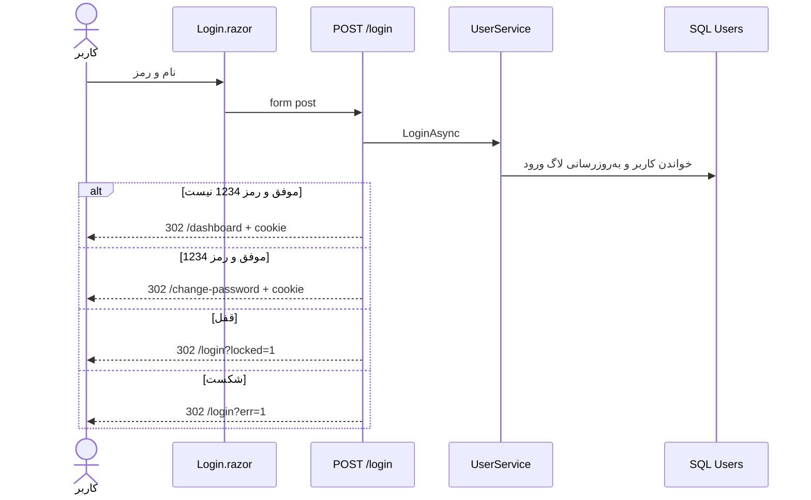
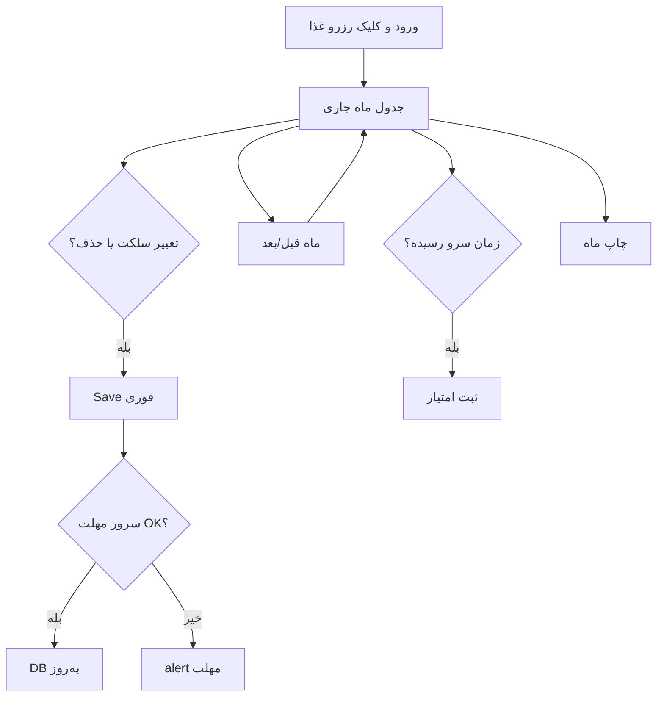

# سفرهای کاربری

این سند رفتار فعلی را بازسازی می‌کند. سفر ماهانه کارمند به‌عنوان **رفتار محصول محافظت‌شده** با جزئیات تعامل ثبت شده است. هیچ پیشنهاد تغییر در این ممیزی نیست.

API جدا برای رزرو وجود ندارد؛ «درخواست سیستم» یعنی فراخوانی سرویس داخل مدار Blazor Server، مگر اینکه HTTP صریح ذکر شود.

---

## J-01 — ورود به سامانه (مشترک)

**نقطه شروع:** `https://host:5001/` یا `/login`

1. `_Host.cshtml` ریشه را رندر می‌کند. `App.razor` اگر مسیر Blazor ناشناخته/خالی باشد `NotFound` خالی داخل `MainLayout` است؛ لاگ اجرا نشان داده `/` به مدار می‌رود و سپس درخواست `/login` هم `_Host` را می‌گیرد.
2. کاربر احرازنشده در هدر لینک «ورود» می‌بیند.
3. صفحه `/login`: فرم HTML کلاسیک `method="post" action="/login"`.
4. **موفق:** `POST /login` → کوکی → `/dashboard` یا `/change-password`.
5. **نامعتبر:** ریدایرکت `/login?err=1` → پیام «نام کاربری یا رمز عبور نادرست است.»
6. **قفل:** `/login?locked=1&until=...` → پیام ساعت پایان قفل.
7. مسیر جایگزین: کاربر از قبل کوکی معتبر دارد و مستقیم به داشبورد/سایر صفحات می‌رود.

تأیید اعتبار: فیلد خالی در UI لاگین اجباری HTML ندارد؛ سرور در `LoginAsync` اگر نام یا رمز خالی باشد `null` می‌دهد → همان `err=1`.

---

## J-02 — سفر محافظت‌شده: انتخاب ماهانه غذای کارمند

این سفر baseline محصول است.

### ۲.۱ ورود به ناحیه انتخاب ماهانه

| گام | عمل کاربر | صفحه/وضعیت | پاسخ سیستم |
|---|---|---|---|
| 1 | لاگین موفق | `/dashboard` | خوش‌آمد + نقش |
| 2 | کلیک «رزرو غذا» در هدر (فقط نقش `کاربر`) | `/user-reservation` | اگر `authState` هنوز null: «در حال بررسی وضعیت ورود...» |
| 3 | اگر احراز نشده | همان مسیر | «ابتدا وارد شوید» — بدون ریدایرکت خودکار به لاگین |
| 4 | بارگذاری | `isLoading` | «در حال بارگذاری...» سپس جدول ماه جاری شمسی |

**پیش‌بارگذاری داده (`OnInitializedAsync`):**

- `userId` از claim `NameIdentifier`
- سال/ماه جاری شمسی
- `LoadMonthData`: همه روزهای ماه، منوها، رزروهای همان userId
- برای هر روز یک `FoodReservation` در دیکشنری `userSelections` (موجود یا خالی)
- `isCurrentRamezan` از منوی **امروز**
- Timer هر ۱۰ ثانیه `StateHasChanged` تا مهلت ساعتی بدون رفرش دستی به‌روز شود

حلقه `for (int i = -1; i <= 1; i++)` ماه‌های مجاور را حساب می‌کند اما نتیجه را استفاده نمی‌کند. روی سفر کاربر اثر مرئی ندارد.

### ۲.۲ صفحه: تقویم ماه به‌صورت جدول

**بالای صفحه**

- دکمه «ماه قبل» / نام ماه فارسی و سال / دکمه چاپ / «ماه بعد»
- بنر زرد ثابت:
  - رمضان (اگر منوی امروز رمضان باشد): ساعت رزرو افطار و شام تا ۱۳ همان روز
  - در غیر این صورت: شام تا ۱۴ همان روز؛ ناهار تا ۱۴ روز قبل

**جدول `#monthTable` ستون‌ها:** تاریخ شمسی، روز هفته، ناهار، شام، امتیاز ناهار، امتیاز شام.

**رنگ ردیف (اولویت تقریبی در کد):**

- امروز: `today-row` سبز
- اگر تعطیل: `holiday-row` (گذشته یا آینده)
- وگرنه اگر پنجشنبه/جمعه: `weekend-row`
- وگرنه اگر گذشته: `past-day` خاکستری

تعطیل و آخر هفته روی `disabled` سلکت اثر ندارند.

### ۲.۳ مشاهده منو و انتخاب‌های قبلی

- گزینه‌ها از `DailyMenu` همان `day.Date`
- اگر رزرو قبلی باشد مقدار سلکت پر است و کلاس `bold-food`
- اگر پشتیبانی وعده را حذف نرم کرده باشد، گزینه «حذف شده توسط پشتیبانی» هست و سلکت disabled است
- امتیاز کلی غذا (ستاره + تعداد رأی) از میانگین محاسبه‌ای منو نشان داده می‌شود حتی قبل از امتیاز شخصی

### ۲.۴ انتخاب غذا برای یک روز (منطق اصلی)

کاربر روی `<select>` ناهار یا شام مقدار را عوض می‌کند.

1. `@onchange` → `OnLunchChanged` / `OnDinnerChanged`
2. مقدار روی `userSelections[day]` ست می‌شود
3. بلافاصله `Save(day)` بدون دکمه تأیید جدا
4. `SaveOrUpdateAsync`
5. موفق: `saveSuccessMap[day]=true` سپس بعد از ۶۰۰ms پاک می‌شود (در مارکاپ فعلی کلاس موفقیت به ردیف وصل نشده)
6. شکست: `alert` با `ex.Message` (متن مهلت سرور)

**مقدار پیش‌فرض سلکت:** `""` با برچسب «انتخاب ناهار» / «انتخاب شام». انتخاب این مقدار هم `onchange` و Save را صدا می‌زند و می‌تواند به شاخه حذف منجر شود.

**تأیید جداگانه پس از انتخاب وجود ندارد.** ذخیره همان لحظه است. این بخش از تجربه فعلی است و باید حفظ شود.

### ۲.۵ ویرایش انتخاب موجود

اگر مهلت UI (`canEditLunch` / `canEditDinner`) برقرار باشد سلکت فعال است. تغییر مجدد همان مسیر Save است. سرور در صورت عدم تغییر واقعی ناهار (برابری رشته) مهلت را دوباره برای آن وعده چک نمی‌کند.

### ۲.۶ حذف انتخاب

دکمه سطل فقط اگر مهلت UI برقرار و مقدار غیرخالی باشد. `Lunch=""` یا `Dinner=""` سپس Save. سرور اگر مهلت گذشته باشد حذف را رد می‌کند.

### ۲.۷ تاریخ‌های محدود یا بدون منو

- گذشته: معمولاً سلکت disabled
- امروز: ناهار معمولاً بسته (غیر رمضان)؛ شام تا ۱۴ (یا ۱۳ رمضان)
- فردا: ناهار تا ۱۴؛ شام باز
- بدون منو: فقط گزینه خالی
- رمضان روی خود روز: الگوی ناهار مثل شام همان‌روز تا ۱۳، نه الگوی «روز قبل»

### ۲.۸ خطاها

| منبع | نحوه نمایش |
|---|---|
| مهلت سرور | `window.alert` متن فارسی استثنا |
| امتیاز خارج از ۱–۵ در UI | alert «لطفاً امتیاز را بین ۱ تا ۵ انتخاب کنید.» |
| استثنای امتیاز سرور | alert همان پیام |
| خطای عمومی امتیاز | «خطایی رخ داد: » + پیام |
| احراز نشده | متن قرمز در صفحه؛ نه مودال |

اعتبارسنجی HTML5 روی سلکت غذا نیست.

### ۲.۹ ناوبری ماه

`ChangeMonth(±1)` سال را در ۱ و ۱۲ دور می‌دهد، `LoadMonthData`، جدول عوض می‌شود. انتخاب‌های ذخیره‌نشده وجود ندارد چون هر تغییر قبلاً Save شده (مگر شکست که state محلی ممکن است با DB ناهمسان بماند تا رفرش).

**پس از شکست Save:** مقدار UI ممکن است مقدار جدید بماند در حالی که DB قدیمی است؛ بارگذاری مجدد ماه با `LoadMonthData` خودکار نیست. **Partially Verified** به‌عنوان لبه همگام‌سازی.

### ۲.۱۰ چاپ

دکمه پرینتر جدول را clone می‌کند، مقدار سلکت را متن می‌کند، دکمه‌ها را برمی‌دارد، پنجره چاپ باز می‌کند.

### ۲.۱۱ تکمیل ماه

مفهوم «ثبت نهایی ماه» یا قفل ماه پس از مهلت کلی وجود ندارد. هر روز مستقل با مهلت خودش ذخیره می‌شود. کارمند می‌تواند ماه بعد/قبل را هم باز کند و در صورت باز بودن مهلت ذخیره کند.

### ۲.۱۲ امتیازدهی در همین صفحه (ادامه سفر)

برای وعده ذخیره‌شده (`Id != 0`):

- قبل از سرو: «پس از سرو غذا»
- اگر Id صفر باشد و روز گذشته: «ابتدا غذا را ذخیره کنید»
- پس از سرو و بدون امتیاز قبلی: عدد ۱–۵ + نظر ۲۰ کاراکتر + دکمه ثبت
- پس از ثبت: ستاره و نظر فقط‌خواندنی

ثبت، ذخیره جدا از انتخاب غذا است و مهلت رزرو را دور نمی‌زند.

### ۲.۱۳ مقادیر پیش‌فرض و حالت‌ها

| موضوع | رفتار فعلی |
|---|---|
| ماه اولیه | ماه شمسی امروز |
| روز بدون رزرو | Lunch/Dinner رشته خالی |
| تأیید | ندارد |
| autosave | بله روی onchange |
| رفرش مهلت | Timer ۱۰ ثانیه |
| نقش در Authorize صفحه | ندارد |

---

## J-03 — داشبورد کارمند / هر نقش

شروع: ریدایرکت پس از لاگین یا لینک داشبورد.

وضعیت در حال بارگذاری تا `GetUserByIdAsync`. سپس کارت خوش‌آمد، نقش، IP ثابت، جدول ورود موفق، جدول شکست.

اگر IP ورود با StaticIP فرق کند قرمز می‌شود. کنترل دسترسی بر اساس این اختلاف نیست.

---

## J-04 — تغییر رمز

شروع: منوی پروفایل یا ریدایرکت اجباری.

اگر لاگین نباشد فقط پیام روی کارت (ریدایرکت ندارد). موفقیت: پیام سبز، پاک شدن فیلدها، پس از حدود ۱ ثانیه `NavigateTo("/dashboard", forceLoad: true)`.

مسئول دفتر لینک پروفایل ندارد ولی مسیر موجود است.

---

## J-05 — پشتیبانی: مدیریت منو

شروع: لینک «مدیریت منو».

1. Authorize نقش پشتیبانی یا مدیریت؛ در `OnInitialized` اگر لاگین نباشد → `/login`. اگر نقش هیچ‌کدام نباشد متن «دسترسی غیرمجاز» اما جدول زیر همان شرط باز هم در مارکاپ بعدی رندر می‌شود (فیلترها و جدول بیرون از `else` نیستند). **Partially Verified:** کاربر غیرمجاز ممکن است جدول را ببیند؛ ذخیره برای غیرپشتیبانی disabled است.
2. سال و ماه را انتخاب و «نمایش».
3. برای هر روز متن غذا، امتیاز، نظرات.
4. پشتیبانی روزهای مجاز را ویرایش و ✔️ می‌زند. «ذخیره شد» نیم‌ثانیه.
5. چک‌باکس تعطیل/رمضان برای پشتیبانی فعال است حتی اگر دکمه ذخیره به‌خاطر تاریخ غیرفعال باشد.

مدیریت: مشاهده؛ ذخیره نه.

---

## J-06 — پشتیبانی: عملیات روزانه رزرو و گزارش

شروع: «رزرو غذاها». اگر نقش پشتیبانی نباشد → `/login`.

1. سه دکمه ماه قبل/جاری/بعد.
2. نوار افقی روزهای ماه؛ پیش‌فرض امروز اگر ماه جاری باشد وگرنه اول ماه.
3. نوار «افزودن غذا»: حالت مهمان یا کاربر، نوع وعده، آیتم منو.
4. مهمان: تعداد + «ثبت مهمان» → N رکورد UserId 129 → alert موفقیت.
5. کاربر: انتخاب از لیست فیلترشده + «ثبت برای کاربر».
6. اگر سفارش باشد: چهار پنل تاشو (onclick `toggleSection`): سفارش ناهار، سفارش شام، لیست ناهار رستوران، لیست شام رستوران، گزارش ماهانه.
7. حذف: confirm فارسی → حذف نرم → رفرش.
8. چاپ هر بخش یا چاپ ماتریس ماه.

پنل‌ها پیش‌فرض بسته‌اند (`display:none` تا `active`).

---

## J-07 — مسئول دفتر: مدیریت کاربران

شروع: «مدیریت کاربران». نقش دیگر → `/login`.

سفرها:

- جستجو نام کاربری (bind بدون دکمه؛ با رندر Blazor فیلتر می‌شود)
- افزودن: فرم کارت، اعتبارسنجی alert، سپس لیست
- ویرایش: فرم جدا؛ برای مسئول دفتر فیلد رمز اختیاری
- حذف: confirm
- بازنشانی رمز/IP: alert نتیجه

کاربر مهمان در جدول مدیران (اگر نقشش کاربر نباشد) یا کاربران ممکن است دیده شود؛ عملیات برای نام `مهمان` مخفی است.

---

## J-08 — نقش مدیریت و شبکه

- **مدیریت:** لاگین → داشبورد. منوی غذا/رزرو کارمند/کاربران در هدر نیست. مسیر `/menu-management` با Authorize باز است و عمدتاً فقط‌خواندنی.
- **شبکه:** لاگین → داشبورد. مسیرهای عملیاتی Authorize را رد می‌کنند.

سفر اختصاصی دیگری در سورس نیست.

---

## مسیرهای جایگزین و لبه

| مسیر | رفتار |
|---|---|
| URL مستقیم `/user-reservation` با نقش پشتیبانی | صفحه رزرو کارمند بار می‌شود (احراز کافی است) |
| انتخاب شام گارد غیر رمضان | گزینه‌ها از ناهار منو |
| چاپ بدون جدول | `getElementById('monthTable')` اگر loading باشد ممکن است خطا دهد — لبه Unverified در اجرا |
| NotFound | بدنه خالی داخل layout |
| `/accessdenied` و `/Error` | مقصد پیکربندی‌شده؛ صفحه موجود نیست |
