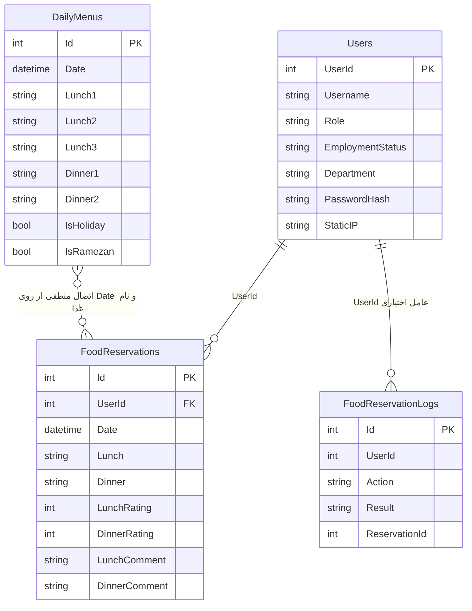

# مدل دامنه و داده

اسکیمای SQL و Migration در مخزن نیست. مدل زیر از کلاس‌های EF، `AppDbContext` و قرارداد پیش‌فرض EF Core است. نام جدول واقعی در SQL Server **Unverified** است مگر اینکه با نام `DbSet` یکی باشد.

---

## تمایز لایه‌ها

| لایه | مثال | پایدار در DB؟ |
|---|---|---|
| موجودیت EF | `User`, `DailyMenu`, `FoodReservation`, `FoodReservationLog` | بله (قصد کد) |
| مدل ورودی | `UserInputModel`, `LoginResult` | خیر |
| DTO گزارش | `DailyFoodSummary`, `DailyUserOrder`, `UserMonthlySummary` | خیر |
| وضعیت فرانت | `userSelections`, `saveSuccessMap`, `guestMealCount` | خیر |
| `[NotMapped]` | `IsLunchRatingSaved`, `IsDinnerRatingSaved`, لیست نظرات منو، میانگین امتیاز منو | خیر؛ محاسبه یا فلگ UI |

---

## موجودیت‌ها

### E-User (`ServiceApp.Models.User`)

- **معنی کسب‌وکار:** حساب ورود یک فرد یا هویت سیستمی (مثل مهمان).
- **PK:** `UserId` (قرارداد EF)
- **فیلدها:** `Username`, `Role`, `EmploymentStatus`, `Department`, `ProfileImagePath`, `PasswordHash`, `FailedLoginAttempts`, `LastFailedLogin`, `LastFailedLoginIP`, `LastLoginTime`, `CurrentLoginTime`, `LastLoginIP`, `CurrentLoginIP`, `StaticIP`
- **روابط:** یک‌به‌چند با `FoodReservation` از سمت رزرو (`UserId`, ناوبری `User`)
- **چرخه:** ایجاد توسط مسئول دفتر؛ به‌روزرسانی نقش/دپارتمان/وضعیت؛ حذف فیزیکی `Remove`
- **قواعد:** BR-19 تا BR-27
- **منبع:** `Models/User.cs`, `Services/AppDbContext.cs` `DbSet<User> Users`
- **`ProfileImagePath`:** در UI استفاده نشد — Unverified کاربرد عملی

### E-DailyMenu (`ServiceApp.Models.DailyMenu`)

- **معنی:** گزینه‌های غذای یک تاریخ.
- **PK:** `Id`
- **فیلدهای پایدار:** `Date`, `Lunch1`, `Lunch2`, `Lunch3`, `Dinner1`, `Dinner2`, `Lunch*RatingAvg/Count`, `Dinner*RatingAvg/Count`, `IsHoliday`, `IsRamezan`
- **فیلدهای NotMapped:** `Lunch1Comments` … `Dinner2Comments`
- **روابط:** کلید خارجی به رزرو ندارد. اتصال منطقی از طریق برابر بودن `Date` با `FoodReservation.Date` و برابر بودن نام غذا با `Lunch`/`Dinner`.
- **چرخه:** insert یا update بر اساس تاریخ
- **ابهام:** فیلدهای RatingAvg/Count روی موجودیت هستند اما `SaveOrUpdateAsync` منو آن‌ها را نمی‌نویسد؛ هنگام Get از رزروها روی شیء ست می‌شوند و ممکن است به DB برگردند یا نه بسته به tracking — **Partially Verified**
- **منبع:** `Models/DailyMenu.cs`, `MenuService`

کاتالوگ غذا جدا نیست. «آیتم غذا» = رشته متن.

### E-FoodReservation (`ServiceApp.Models.FoodReservation`)

- **معنی:** انتخاب ناهار و/یا شام یک کاربر در یک روز.
- **PK:** `Id`
- **FK:** `UserId` → `User`
- **فیلدها:** `Date`, `Lunch`, `Dinner`, `Department`, `LunchRating`, `DinnerRating`, `CreatedAt`, `UpdatedAt`, `LunchComment`, `DinnerComment`
- **NotMapped:** `IsLunchRatingSaved`, `IsDinnerRatingSaved`
- **چرخه:** Create/Update از `SaveOrUpdateAsync`؛ حذف نرم متنی؛ امتیاز روی همان ردیف
- **`Department` روی رزرو:** در مهمان نوشته می‌شود؛ گزارش روزانه از دپارتمان User می‌خواند
- **منبع:** `Models/FoodReservations.cs`

یکتایی دیتابیسی UserId+Date در `OnModelCreating` تعریف نشده. یکتایی منطقی در کد برای همه به‌جز UserId 129 اعمال می‌شود.

### E-FoodReservationLog (`ServiceApp.Models.FoodReservationLog`)

- **معنی:** رد عملیات رزرو.
- **فیلدها:** `Id`, `UserId` (عامل، نه لزوماً صاحب رزرو), `UserName`, `CreatedAt`, `Action` (`Create`/`Update`/`Delete`), `Result` (`Success`/`Failed`), `ReservationId`, `ReservationDate`, `MealType` (`Lunch`/`Dinner`/`Both`/`None`), مقادیر قدیم/جدید وعده، `ErrorMessage`, `IpAddress`
- **UI برای مشاهده لاگ یافت نشد.** فقط نوشتن.
- **منبع:** `Models/FoodReservationLog.cs`, `SaveLogOnlyAsync`

### مدل‌های غیرپایدار

- `DailyFoodSummary`: `Date`, `LunchCount`, `DinnerCount`
- `DailyUserOrder`: برشی از رزرو+نام کاربر
- `Print`: خالی
- `MealType` enum در `FoodReservationService.cs`: `Lunch`, `Dinner`
- `UserMonthlySummary` تو در تو در صفحه گزارش

---

## روابط

نام مجموعه‌ها در DbContext: `Users`, `DailyMenus`, `FoodReservations`, `FoodReservationLogs`.

محدودیت طول نظر در Fluent API: ۲۰ کاراکتر Unicode.

---

## مالکیت و زمان

- رزرو متعلق به `UserId` است.
- منو متعلق به تاریخ است نه به نقش.
- امتیاز متعلق به همان رزرو است نه جدول جدا.
- سازمان: فقط `User.Department` رشته‌ای.
- ترتیب زمانی رزرو: `CreatedAt` / `UpdatedAt`؛ انتخاب آخرین رزرو روز با `OrderByDescending(UpdatedAt).ThenByDescending(Id)`.

---

## شماره‌ها و هویت‌های جادویی

| مقدار | محل | معنی در کد |
|---|---|---|
| `UserId = 129` | `SaveOrUpdateAsync`, `AddGuestMeal` | مسیر مهمان چندردیفی |
| `"مهمان"` | گزارش و فیلتر کاربر | برچسب و نام کاربری ویژه |
| `"Guards-"` | پیشوند Username | قاعده شام-به‌عنوان-ناهار |
| `"حذف شده توسط پشتیبانی"` | مقدار وعده | حذف نرم |
| `"1234"` | اجبار و بازنشانی رمز | رمز موقت |
| `"نگهبانی"` | دپارتمان مهمان | رشته ثابت |

وجود ردیف کاربر ۱۲۹ و کاربر `مهمان` در دیتابیس واقعی **Unverified** (سورس seed ندارد).
