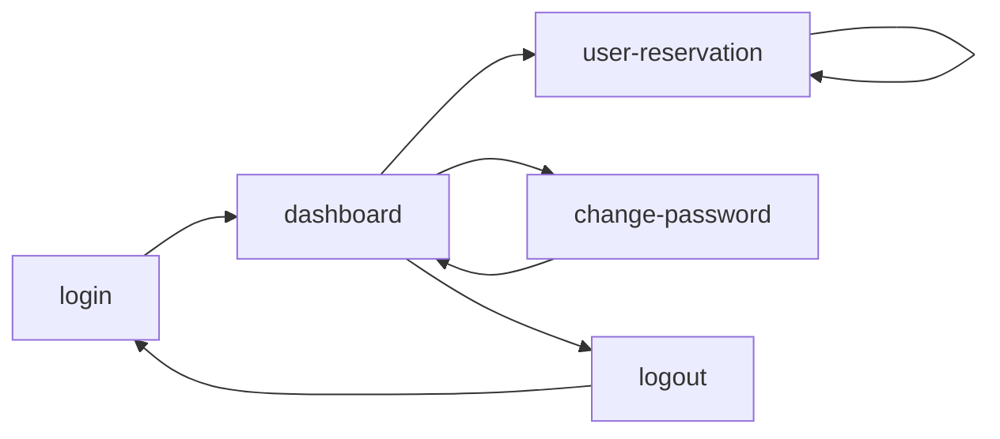

# ناوبری و معماری اطلاعات

ناوبری اصلی یک هدر افقی RTL در `Shared/MainLayout.razor` است. سایدبار، بردکرامب، و منوی تو در تو وجود ندارد.

---

## ۱. سلسله‌مراتب سایت

```text
/_Host (shell)
├── /login                          ورود (عمومی)
├── /logout                         خروج HTTP
├── /dashboard                      داشبورد (احراز)
├── /change-password                تغییر رمز (احراز در کد)
├── /user-reservation               رزرو ماهانه کارمند (احراز در مارکاپ)
├── /menu-management                منو (پشتیبانی یا مدیریت)
├── /food-reservations              گزارش رزرو (پشتیبانی)
├── /user-management                کاربران (مسئول دفتر)
├── /install/ca.cert.crt            فایل استاتیک
├── /install/How_to_Install_Root_CA_Certificate.pdf
└── (NotFound)                      بدنه خالی
```

مقصدهای پیکربندی‌شده بدون صفحه: `/accessdenied`, `/Error`.

---

## ۲. هدر بر اساس نقش

پس از احراز:

همه: داشبورد + پروفایل (ساعت، تاریخ شمسی، منوی دایره‌ای).

| نقش | لینک‌های اضافه |
|---|---|
| `مسئول دفتر` | مدیریت کاربران — بدون لینک تغییر رمز |
| `پشتیبانی` | مدیریت منو، رزرو غذاها |
| `کاربر` | رزرو غذا |
| سایر | فقط داشبورد |

پروفایل: تغییر رمز (اگر مسئول دفتر نباشد)، نصب گواهی، آموزش نصب، خروج.

کاربر مهمان هدر «ورود» می‌بیند.

Active link: `NavManager.Uri.EndsWith(href)`.

---

## ۳. موجودی مسیر

| مسیر | مؤلفه | هدف | نقش/مجوز | ورود | اقدامات مرتبط | سرویس/API |
|---|---|---|---|---|---|---|
| `/` | `_Host.cshtml` `@page "/"` | پوسته HTML | عمومی | آدرس ریشه | رندر Blazor | — |
| `/login` | `Login.razor` | ورود | عمومی | منو، ریدایرکت شکست، Logout | POST فرم | `POST /login` |
| `/logout` | minimal API | خروج | کوکی | پروفایل | SignOut | `GET /logout` |
| `/dashboard` | `Dashboard.razor` | وضعیت ورود | `[Authorize]` | پس از لاگین، منو | نمایش | `UserService.GetUserByIdAsync` |
| `/change-password` | `ChangePassword.razor` | تغییر رمز | احراز در `OnInitialized` | پروفایل، ریدایرکت رمز 1234 | ذخیره | `ChangePasswordAsync` |
| `/user-reservation` | `UserReserve.razor` | انتخاب ماهانه | `IsAuthenticated` در UI؛ بدون Roles | منو برای `کاربر` | سلکت، حذف، امتیاز، چاپ، ماه | `MenuService`, `FoodReservationService` |
| `/menu-management` | `MenuManagement.razor` | منوی غذایی | `[Authorize(Roles = "پشتیبانی,مدیریت")]` | منو پشتیبانی | نمایش ماه، ذخیره روز | `MenuService` |
| `/food-reservations` | `FoodReservations.razor` | گزارش و عملیات | `[Authorize(Roles = "پشتیبانی")]` + ریدایرکت | منو پشتیبانی | فیلتر تاریخ، افزودن، حذف، چاپ | `ReservationService`, `FoodReservationService`, `MenuService` |
| `/user-management` | `UserManagement.razor` | حساب‌ها | `[Authorize(Roles = "مسئول دفتر")]` + ریدایرکت | منو مسئول دفتر | CRUD، ریست | `UserService` |
| `/install/...` | استاتیک | گواهی | هر کس که URL دارد (لینک پس از لاگین) | پروفایل | دانلود | فایل |

گارد ناوبری متمرکز (AuthorizeRouteView / RedirectToLogin component) نیست. `[Authorize]` روی چهار صفحه است. Router در `App.razor` از `RouteView` ساده استفاده می‌کند.

Deep link: مسیرها مستقیم‌اند؛ query فقط روی لاگین (`err`, `locked`, `until`).

مودال محصولی جدا نیست. confirm/alert مرورگر برای حذف و خطا.

---

## ۴. گردش داخلی صفحات (غیر از route)

### رزرو کارمند
ماه قبل/بعد همان route؛ state محلی عوض می‌شود.

### گزارش پشتیبانی
انتخاب ماه و روز همان route. پنل‌ها با JS `toggleSection` باز/بسته می‌شوند بدون تغییر URL.

### مدیریت کاربران
فرم افزودن/ویرایش toggle روی همان صفحه.

### مدیریت منو
تغییر سال/ماه تا کلیک «نمایش» داده را عوض می‌کند (`@bind` روی select بدون load خودکار).

---

## ۵. ریدایرکت‌ها

| از | به | شرط |
|---|---|---|
| `POST /login` موفق | `/dashboard` | رمز موقت نیست |
| `POST /login` موفق | `/change-password` | هش = 1234 |
| `POST /login` نامعتبر | `/login?err=1` | |
| `POST /login` قفل | `/login?locked=1&until=` | |
| `GET /logout` | `/login` | |
| FoodReservations init | `/login` | غیرپشتیبانی یا بدون لاگین |
| UserManagement init | `/login` | غیر مسئول دفتر |
| MenuManagement init | `/login` | بدون لاگین |
| ChangePassword موفق | `/dashboard` forceLoad | |

کوکی `AccessDeniedPath=/accessdenied` اگر Authorize شکست بدهد به مسیر بدون صفحه می‌رود.

---

## ۶. دیاگرام ناوبری نقش کاربر


