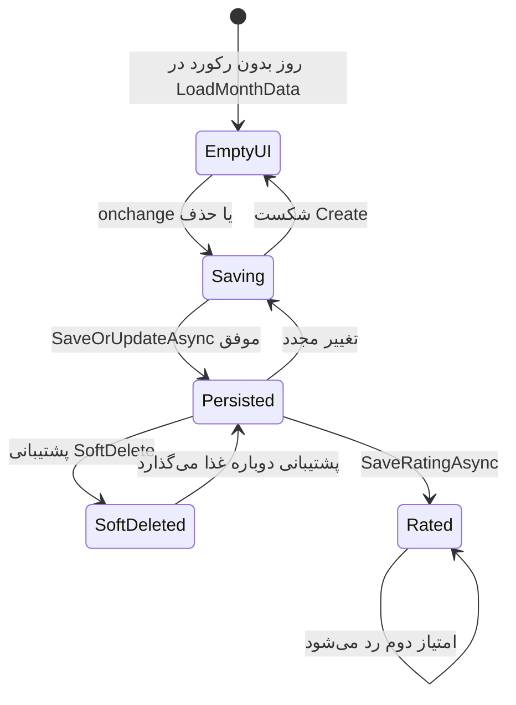
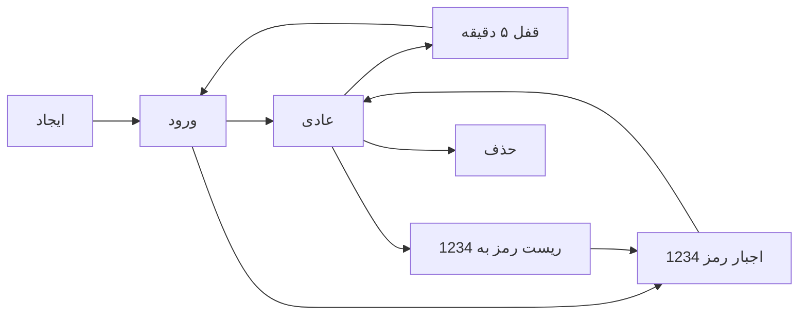

# وضعیت برنامه و چرخه عمر

---

## ۱. مدیریت وضعیت فرانت

الگوی کلی: Blazor Server با فیلدهای `@code` در هر صفحه. کتابخانه state سراسری (Flux، Fluxor، Redux) نیست.

| محل | نوع state | ماندگاری |
|---|---|---|
| `UserReserve` | `menus`, `monthDates`, `userSelections`, ماه/سال، `authState`, `isLoading`, `isCurrentRamezan`, `saveSuccessMap` | مدار؛ با تعویض صفحه از بین می‌رود |
| `FoodReservations` | تاریخ، سفارش‌ها، خلاصه، منوی روز، ماه‌ها، حالت افزودن مهمان | مدار |
| `MenuManagement` | لیست منو، سال/ماه، فلگ نقش | مدار |
| `UserManagement` | لیست کاربران، فرم‌ها، `searchTerm` | مدار |
| `MainLayout` | `authUser`, ساعت، `UnreadCount` (همیشه ۰) | مدار |
| Timer رزرو | هر ۱۰ ثانیه رندر برای مهلت | فقط UI |
| Timer ساعت هدر | هر ۱ ثانیه | فقط UI |

`localStorage` / `sessionStorage` در JS محصول (`site.js`) نیست. `site.js` فقط `toggleProfileMenu` است.

---

## ۲. وضعیت سرور و نشست

| مکانیزم | استفاده |
|---|---|
| Cookie auth | هویت ۸ ساعته sliding |
| `HttpContext.Session` | `ChangePassUserId` هنگام اجبار رمز؛ خوانده نمی‌شود |
| EF `AppDbContext` Scoped | هر مدار/درخواست |
| Serilog فایل | لاگ درخواست میزبان |
| `IMemoryCache` پکیج | ثبت سرویس محصولی یافت نشد |
| `AddSession` بدون `AddDistributedMemoryCache` صریح در `Program.cs` | پیکربندی حداقل؛ جزئیات پایداری session **Partially Verified** |

Circuit Blazor Server منبع حقیقت UI در حین اتصال است. قطع اتصال رفتار پیش‌فرض فریم‌ورک است و سفارشی‌سازی در سورس دیده نشد.

---

## ۳. همگام‌سازی رزرو

پس از Save موفق، صفحه دوباره از DB نمی‌خواند؛ `Id` رزرو جدید ممکن است در شیء trackشده EF روی همان instance ست شود (وابسته به tracking). اگر Create باشد، شیء ارسالی همان `userSelections` است که بعد از Add به context وصل می‌شود. **Partially Verified** پر شدن `Id` برای امتیاز همان جلسه.

اگر Save شکست بخورد، UI مقدار جدید را نگه می‌دارد تا کاربر ماه را عوض کند یا صفحه را رفرش کند.

---

## ۴. چرخه منو

روز بدون ردیف DB: شیء حافظه‌ای در لیست UI. تا Save، در `GetMenusForMonth` برای کارمند ظاهر نمی‌شود (کارمند فقط منوهای موجود DB را می‌بیند). بنابراین روز بدون منوی ذخیره‌شده گزینه‌ای ندارد. **Verified.**

به‌روزرسانی منوی موجود نام غذا را عوض می‌کند؛ رزروهای قبلی همان رشته قدیمی را نگه می‌دارند (cascade به رزرو نیست).

---

## ۵. چرخه انتخاب کارمند در ماه

قفل سراسری «ماه بسته شد» نیست. هر سلول با ساعت سیستم سرور (`DateTime.Now`) مستقل است. Timer ده ثانیه‌ای UI را با ساعت کلاینت/سرور مدار هم‌تراز می‌کند (هر دو `DateTime.Now` سمت سرور مدار).

---

## ۶. چرخه حساب

`FailedLoginAttempts` روی خود `User` است نه جدول تلاش جدا (جز فیلدهای آخرین شکست).

---

## ۷. کوکی و HTTPS

کوکی احراز پس از POST لاگین. مدار بعدی claimها را از کوکی می‌خواند (در صورت کارکرد `AuthenticationStateProvider`).

گواهی کلاینت برای اعتماد به CA داخلی از مسیر استاتیک دانلود می‌شود و به state برنامه وصل نیست.
